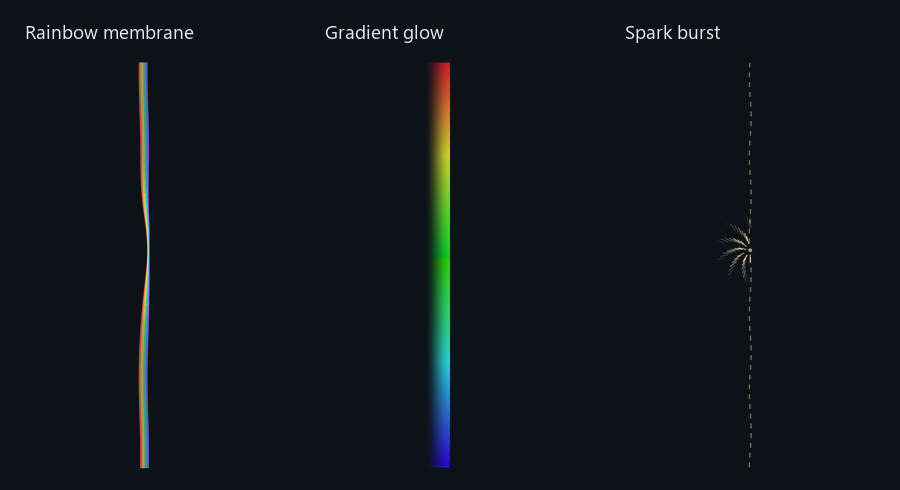
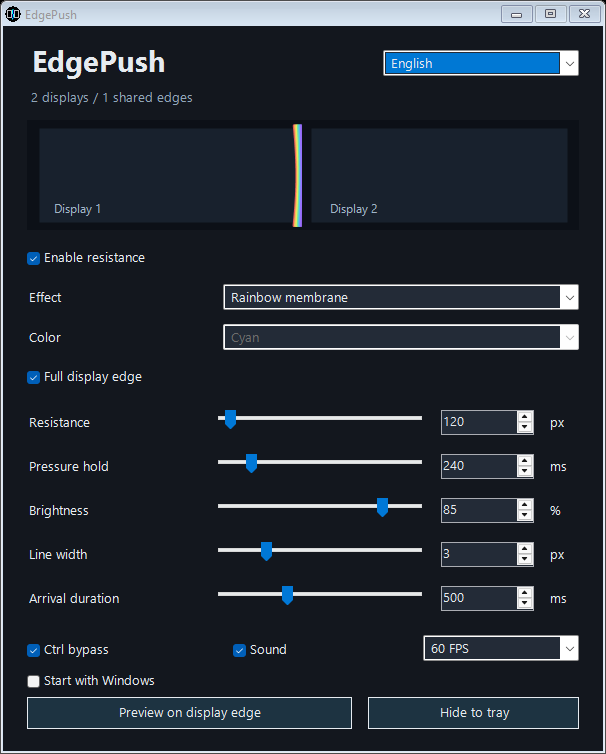
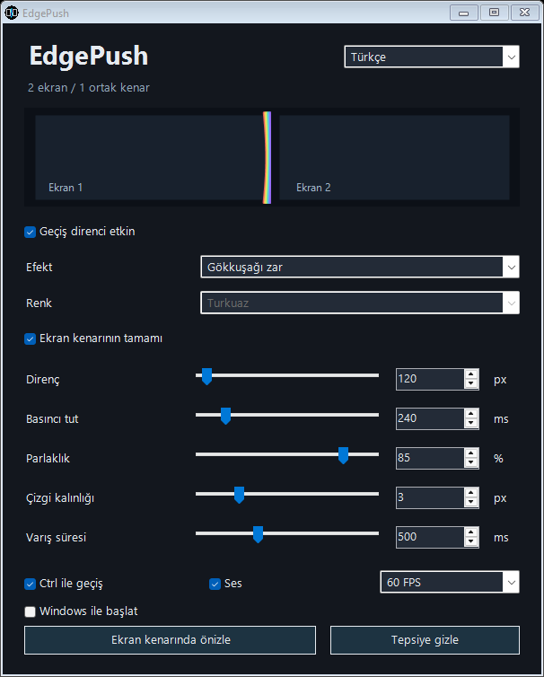

# EdgePush

A small Windows utility that adds resistance and visual effects when your mouse crosses between displays on the **same computer**.

**[Download the latest Windows release](https://github.com/Fatihx64/EdgePush/releases/latest)** · [Türkçe](#türkçe) · [MIT license](LICENSE)



## Get started

1. Download and extract `EdgePush-Windows-x64.zip` from Releases into a writable folder.
2. Run `EdgePush.exe`. It starts in the system tray.
3. Double-click its tray icon to open Settings.
4. Push the mouse against a shared display edge. Pressure builds until the configured resistance is overcome.

Hold **Ctrl** to bypass resistance when that option is enabled. Closing Settings with **×** hides the window to the tray. Use **Exit** in the tray menu to stop EdgePush.

Requirements: Windows 10/11 x64 and .NET Framework 4.8. No Python, browser engine, network connection or administrator account is required for normal use. The executable is unsigned; Windows may show a reputation warning.

## Settings



| Setting | What it changes |
| --- | --- |
| Resistance | Accumulated mouse travel needed to cross, 40–2400 px |
| Pressure hold | Pause before accumulated pressure starts to decay, 80–1200 ms |
| Brightness | Overlay opacity, 15–100% |
| Line width | Effect stroke width, 1–10 px |
| Arrival duration | Breakthrough animation duration, 150–1200 ms |
| Frame rate | 15, 30, 60 or 120 FPS target |
| Full display edge | Draw the whole edge of the source display, rather than a short local effect |
| Start with Windows | Register this executable for sign-in startup for the current Windows user |

All five numeric settings support **both dragging a slider and typing a number**. They stay synchronized. Changes apply immediately; nearby disk writes are combined. English is the initial language; Turkish can be selected and is remembered. Color selection is disabled for effects with a fixed palette and enabled again for effects that support it.

Effects: Portal, Wave, Crystal, Line, Electric, Sparks, Aurora, Rainbow membrane, Gradient glow and Spark burst. Choose Off to keep resistance without visual effects. Rainbow membrane bends toward the cursor and opens during breakthrough; it has no extra arrival outline.

The tray menu also pauses resistance and refreshes display geometry. Refresh displays after changing monitor arrangement. Vertically stacked displays and negative desktop coordinates are supported. The actual transfer area is the shared boundary; the full-edge visual can extend beyond that overlap. Diagonal transitions at the ends of a shared edge are checked against both neighboring monitors.

## Startup, files and removal

`settings.json` is saved beside the executable. Keep the folder writable. The optional `click.wav` plays on breakthrough. Disable Sound to mute it.

Start with Windows is opt-in. Enabling it writes only the `EdgePush` value under `HKCU\Software\Microsoft\Windows\CurrentVersion\Run`; disabling removes this application's matching value. It points to the current executable location. If you move the folder, turn the option off before moving and on again afterward. If Windows policy blocks the change, the application reports the failure. Startup registration does not request elevation.

To remove EdgePush: disable Start with Windows, choose Exit in the tray menu, then delete its folder. Closing Settings alone does not stop it.

## Performance and limits

Effects use a narrow transparent GDI+ overlay. The animation clock is stopped while idle. Modern Windows uses a high-resolution waitable timer, with a regular waitable-timer fallback. FPS is a target, not a guarantee: rendering cost, scheduling and monitor refresh rate limit the visible result.

This is a local multi-monitor utility, not a network KVM. Secure desktops/UAC, elevated applications, exclusive fullscreen games, sleep/resume and every mixed-DPI layout have not been exhaustively verified. Absolute or injected pointer events are passed through; those input methods can bypass resistance. No telemetry or background network service is included.

See [validation details](source/docs/VALIDATION.md) for the tested scenarios and their limits. [High-resolution waitable timers](https://learn.microsoft.com/en-us/windows/win32/api/synchapi/nf-synchapi-createwaitabletimerexw) require Windows 10 version 1803 or later; older versions use the fallback.

## Folder layout

Everyday files are kept at the top level: `EdgePush.exe`, `click.wav`, `settings.json`, README and license. Development code, assets, scripts and validation are under `source/`. Build output stays in ignored `source/dist/`.

## Build and test

```powershell
powershell -ExecutionPolicy Bypass -File source/build.ps1
powershell -ExecutionPolicy Bypass -File source/test.ps1
```

The build uses the C# compiler included with .NET Framework. No package restore or network access is needed. Output is `source/dist/EdgePush.exe`; the build also copies the transition sound there. Run the built executable with `--settings` to open Settings immediately.

Developer checks: `--self-test` tests geometry, `--diagnostics` tests settings and rendering, and `--clock-test` samples animation-clock callbacks. They write reports beside the tested executable and should be run in a writable test folder. The tests do not enable Windows startup.

Source: `source/EdgePush.cs`. Icon: `source/assets/EdgePush.ico`; regenerate it with `source/make-icon.ps1`. Contributions and reproducible bug reports are welcome. For a boundary issue, include display resolutions, relative placement, scaling percentages, direction and selected resistance; do not include private desktop screenshots.

## Türkçe

EdgePush, **aynı bilgisayara bağlı ekranlar** arasında fare geçişine direnç ve görsel efekt ekleyen küçük bir Windows aracıdır.

**[Son Windows sürümünü indir](https://github.com/Fatihx64/EdgePush/releases/latest)**, ZIP'i yazılabilir bir klasöre çıkar ve `EdgePush.exe` dosyasını çalıştır. Uygulama sistem tepsisinde başlar; simgeye çift tıklayarak ayarları aç. Varsayılan dil İngilizcedir; sağ üstten Türkçe seçilebilir.



Fareyi ortak ekran sınırına doğru ittikçe basınç birikir. Direnç aşılınca karşı ekrana geçilir. İzin verildiğinde Ctrl ile serbestçe geçilebilir. Ayarlar penceresindeki **×**, uygulamayı tepsiye gizler; tamamen kapatmak için tepsi menüsünden **Çıkış** seçilir.

- Beş sayısal ayar hem slider sürüklenerek hem sayı yazılarak düzenlenir; değerler eşleniktir.
- Direnç 40–2400 px, basıncı tutma 80–1200 ms, parlaklık %15–100, çizgi 1–10 px, varış süresi 150–1200 ms.
- 15/30/60/120 FPS hedefi; ses, Ctrl geçişi ve tüm ekran kenarını kaplama seçenekleri bulunur.
- Gökkuşağı zar, yumuşak renk geçişi, altın kıvılcım ve diğer efektler seçilebilir. Kendi paletini kullanan efektlerde renk seçimi kapanır; destekleyenlerde yeniden açılır.
- Tam kenar modu kaynak ekranın bütün kenarını çizer. Gerçek fare geçişi ortak sınırla sınırlıdır; çapraz köşe hareketleri de kontrol edilir.
- Windows ile başlat seçeneği varsayılan olarak kapalıdır. Açıldığında yalnız geçerli kullanıcı için başlangıç kaydı eklenir. Klasörü taşımadan veya silmeden önce bu seçeneği kapatın.

Windows 10/11 x64 ve .NET Framework 4.8 gerekir. Normal kullanımda yönetici izni, Python, tarayıcı veya ağ bağlantısı gerekmez. Ayarlar EXE yanındaki `settings.json` dosyasına yazılır. Windows ilkesi başlangıç kaydına izin vermezse hata bildirilir. Ekran yerleşimini değiştirince tepsi menüsünden ekranları yeniden algılayın.

Efektler boşta sürekli çizilmez. FPS, donanım ve Windows zamanlamasıyla sınırlı bir hedeftir. Ağ üzerinden başka bilgisayara geçiş yapılmaz. UAC, oyunlar, uyku sonrası ve tüm karma DPI düzenleri kapsamlı biçimde test edilmiş değildir. Enjekte edilen veya mutlak konum kullanan fare girdileri dirençten geçebilir.

Derlemek için yukarıdaki `source/build.ps1`, kontroller için `source/test.ps1` komutlarını kullanın. Kaynak kod MIT lisansıyla açıktır; [doğrulama notları](source/docs/VALIDATION.md) test kapsamını ve sınırlarını açıklar.

